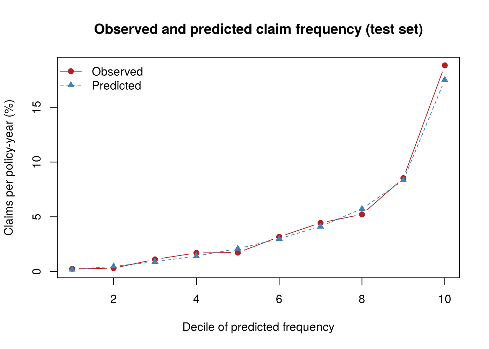
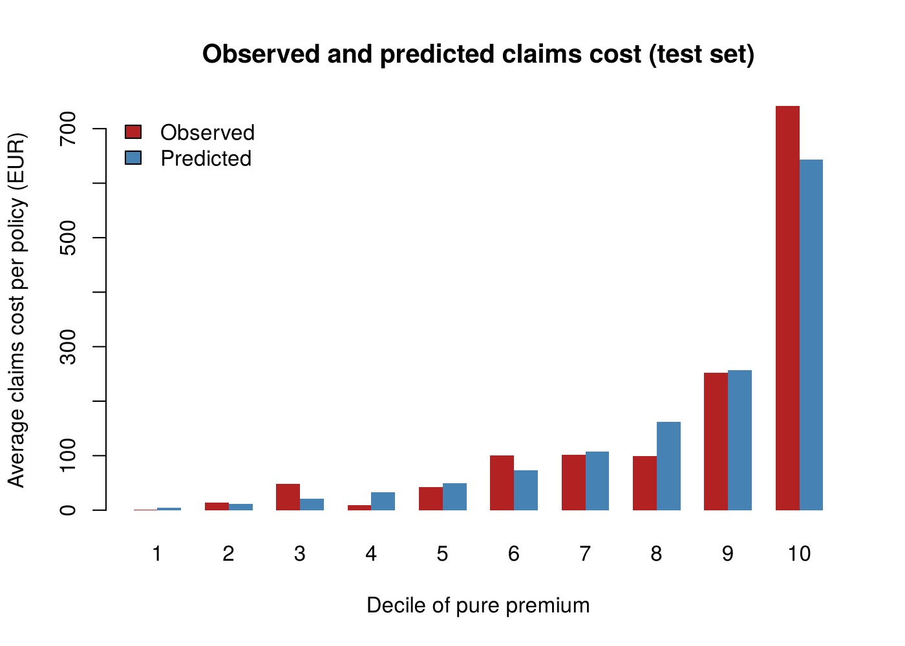

# Car Insurance Pricing

Academic project in non-life actuarial science (Master Actuariat & Finance, University of Rouen Normandie). Originally a group project of three students; this version is a full rework of the code. The code and its comments are in French.

## Goal
Build a car insurance tariff from a policy portfolio, a claims database and telematics data: pure premium with a frequency × severity model, then technical and commercial premium.

## Data
- Portfolio: 100,399 rows, 99,837 contracts after cleaning
- Claims: 4,044 claims with a positive cost, total 13.56 MEUR
- Telematics: 100,332 rows (distance, driving times, harsh braking and acceleration, turns)

The data comes from the course and is not published (see `data/README.md`).

## Method
1. **Data cleaning**: harmonised categories (unknown values kept as `Unknown`), pure and impure duplicates, missing values, consistency between age and years without claims, telematics duplicates (one real row and one empty row per contract).
2. **Train / test split**: 80 / 20 by contract, done once at the start. Variable selection, the capping threshold and every calibration use the training set only. The test set is used only for validation.
3. **Frequency**: Poisson GLM with an exposure offset. Variables selected with a lasso (`glmnet`, 5-fold cross-validation, `lambda.1se`), then the GLM is refitted on the selected variables. Over-dispersion checked against a negative binomial model.
4. **Severity**: cost per claim (amount / number of claims), Gamma GLM with log link, weighted by the number of claims, on costs capped at a threshold chosen with the elbow method. The cost above the threshold is spread over all claims with a loading coefficient.
5. **Pure premium** = annual frequency × capped average cost × loading coefficient.
6. **Commercial premium**: floor 40 EUR, cap 800 EUR, rebalancing so that the total is unchanged, 5% safety loading, 3% acquisition costs.

## Results (test set unless stated otherwise)
| Item | Value |
|---|---|
| Observed annual frequency (whole portfolio) | 4.72% |
| Claims observed / predicted on the test set | 837 / 809 |
| Pearson dispersion (Poisson) | 1.09 |
| Poisson deviance explained vs a model without variables | 17.7% |
| Capping threshold (elbow, training set) | 7,413 EUR (90th percentile) |
| Loading coefficient for the cost above the threshold | 1.27 |
| Mean pure premium | 145 EUR |
| Mean commercial premium | 159 EUR |
| Closing ratio, pure premium / observed claims | 1.006 training, 0.971 test |

Most predictive variables for frequency: distance driven, share of the year driven, weekday driving, car age, credit score, harsh braking and turn intensity.

## Limits
- The cost model is weak (test MAE 2,676 EUR against 2,828 EUR for the plain average): most of the segmentation comes from the frequency model.
- With a 40 EUR floor, 31% of contracts pay the minimum premium. The floor and the cap are commercial choices to be discussed.

## Repository content
- `R/tarification_auto.Rmd`: the full analysis (cleaning, models, premiums), as an R Markdown notebook
- `figures/`: lift charts on the test set
- `data/`: expected data files (not published)

## How to reproduce
1. Install R (4.3 or later) and the packages `readxl`, `glmnet`, `MASS`, `rmarkdown`.
2. Put the three data files in `data/`.
3. Open `R/tarification_auto.Rmd` in RStudio and click Knit (or run `rmarkdown::render("R/tarification_auto.Rmd")`). The report is rendered as HTML and the tariff is written to `out/tarif.csv`. Run time is about one minute.
