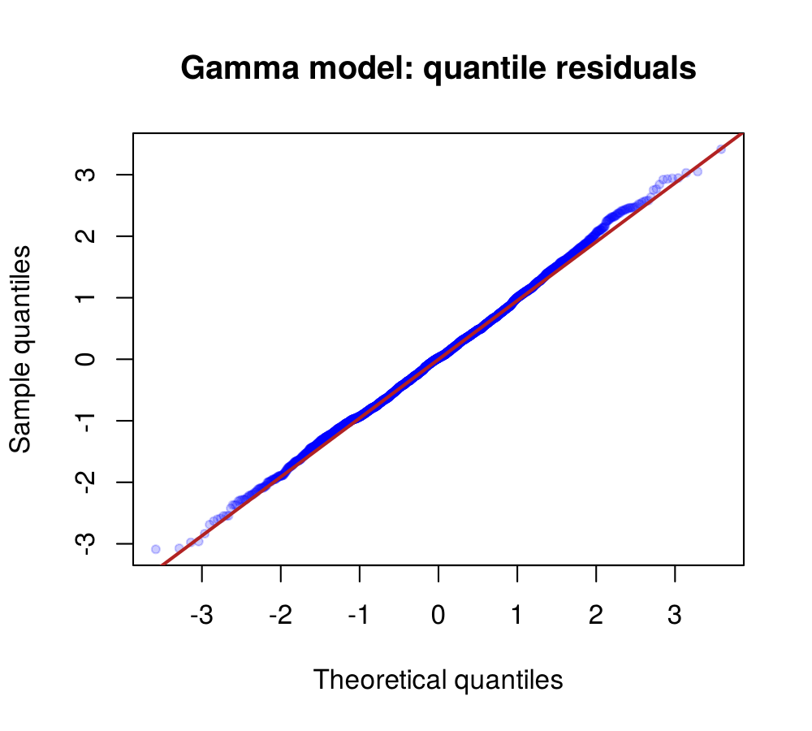
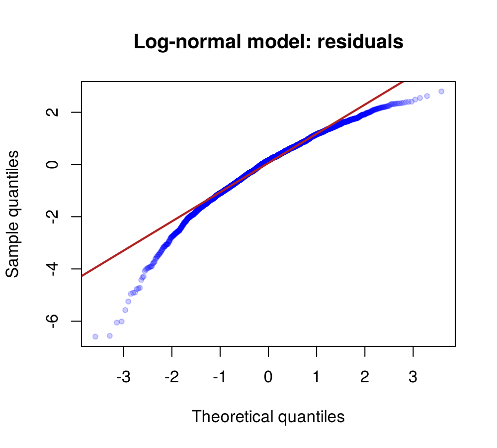

# Car Insurance Pricing

Academic project in non-life actuarial science (Master Actuariat & Finance, University of Rouen Normandie). Originally a group project of three students; this version is a full rework of the code. The code and its comments are in French.

## Goal
Build a car insurance tariff from a policy portfolio, a claims database and telematics data: pure premium with a frequency × severity model, then commercial premium.

## Data
- Portfolio: 100,399 rows, 99,837 contracts after cleaning
- Claims: 4,044 claims with a positive cost, total 13.56 MEUR
- Telematics: 100,332 rows (distance, driving times, harsh braking and acceleration, turns)

The data comes from the course and is not published (see `data/README.md`).

## Method
1. **Data cleaning and descriptive analysis.**
2. **Train / test split** (80 / 20 by contract).
3. **Frequency**: Poisson GLM. Variables selected with a lasso, non-significant variables removed. The exposure coefficient is estimated, because claims are not proportional to the contract duration. Natural splines are used where an effect is not linear.
4. **Severity**, cost per claim split at the 97.5th percentile:
   - attritional claims (below the threshold): Gamma GLM. A log-normal model was tested and rejected, because its residuals are not normal;
   - large claims (above the threshold): share and average cost estimated on the whole portfolio.
5. **Pure premium** = annual frequency × [(1 − p) × predicted attritional cost + p × average large-claim cost].
6. **Commercial premium**: floor 40 EUR, cap 800 EUR, rebalancing, 5% safety loading, 3% acquisition costs.

## Assumptions checked
| Assumption | Check | Result |
|---|---|---|
| Frequency: variance = mean | Pearson dispersion, negative binomial | verified (1.09) |
| Frequency: no excess zeros | observed vs predicted P(N = k) | verified |
| Frequency: claims proportional to duration | test of the exposure coefficient | rejected, coefficient estimated (0.68) |
| Linear effects of continuous variables | spline tests | splines where needed |
| Attritional cost: log-normal | residual Q-Q plot | rejected |
| Attritional cost: Gamma | quantile residual Q-Q plot | verified |
| Log link | test of the squared linear predictor | verified for severity; small departure for frequency, no effect on the test set |
| No influential observation | Cook's distance | verified |
| No omitted interaction or variable | usage × area, territory | none for frequency; territory effect on severity not included |
| Frequency and severity independent | Wilcoxon test | verified |
| Independent policyholders | one row per contract | assumed |

## Results
| Item | Value |
|---|---|
| Claims observed / predicted on the test set | 837 / 808 |
| Poisson deviance explained | 18.0% training, 18.6% test (no overfitting) |
| Large-claim threshold | 16,584 EUR (2.5% of claims, average cost 26,814 EUR) |
| Claims cost predicted / observed on the test set | 1.007 |
| Closing ratio, predicted / observed claims cost | 1.008 training, 0.968 test |
| Mean annual pure premium | 143 EUR |
| Mean commercial premium | 155 EUR |

## Limits
- p-values after lasso selection are optimistic.
- The large-claim cost is the same for every policyholder, as there are too few large claims to model it.
- Territory has an effect on claim cost that is not included.
- With a 40 EUR floor, about a third of contracts pay the minimum premium.
- The annual premium uses telematics measured over the contract duration, without annualising it.

## Repository content
- `R/tarification_auto.Rmd`: the full analysis, as an R Markdown notebook
- `figures/`: lift charts and residual plots
- `data/`: expected data files (not published)

## How to reproduce
1. Install R (4.3 or later) and the packages `readxl`, `glmnet`, `MASS`, `rmarkdown`.
2. Put the three data files in `data/`.
3. Open `R/tarification_auto.Rmd` in RStudio and click Knit. The report is rendered as HTML and the tariff is written to `out/tarif.csv`.
